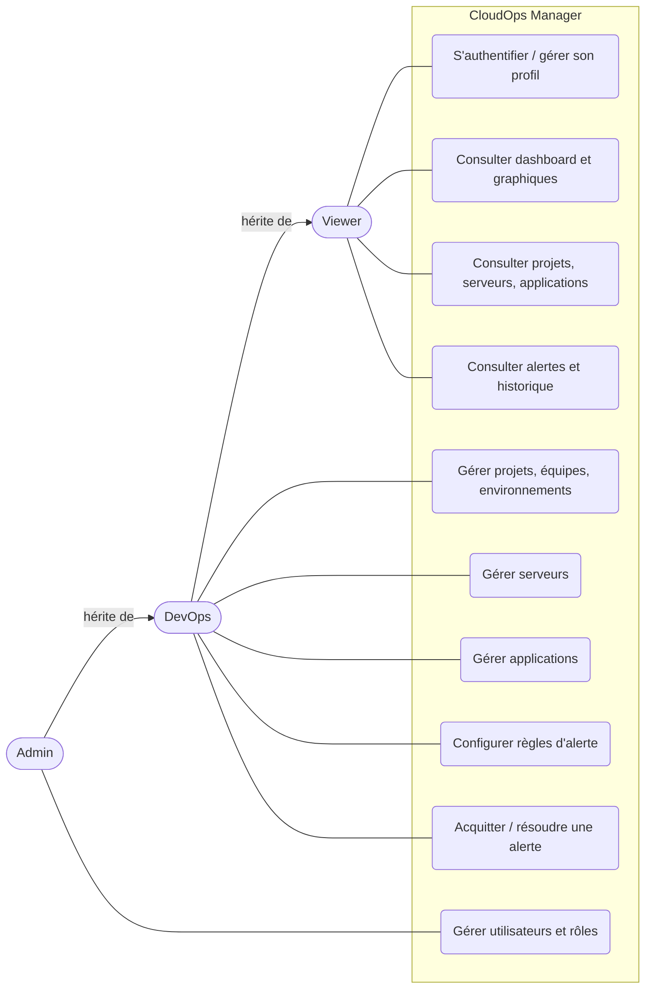
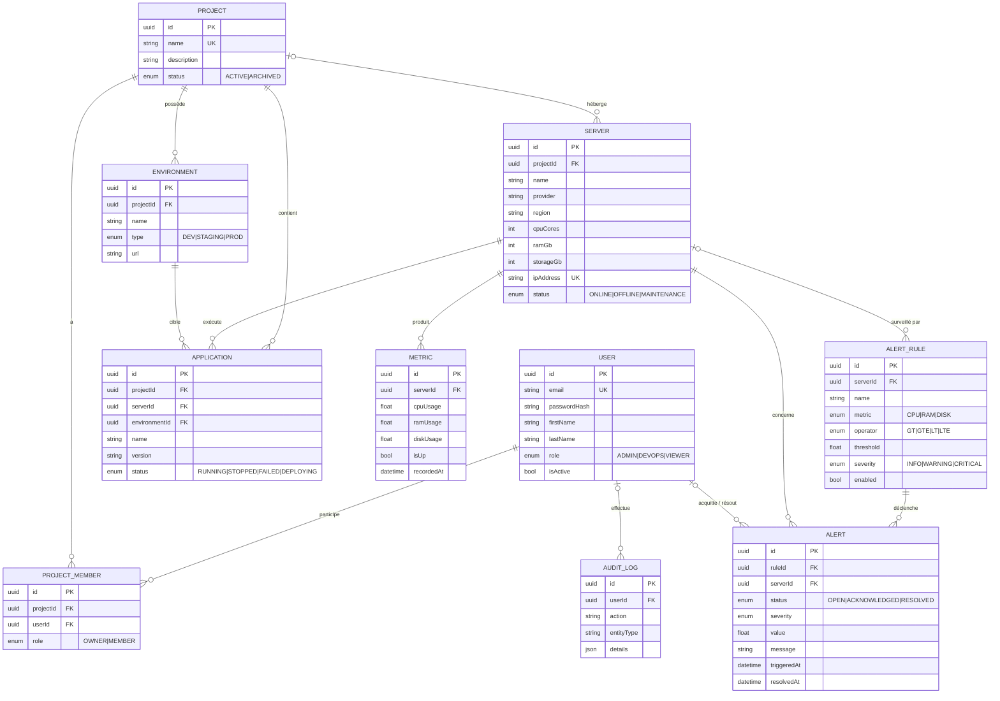
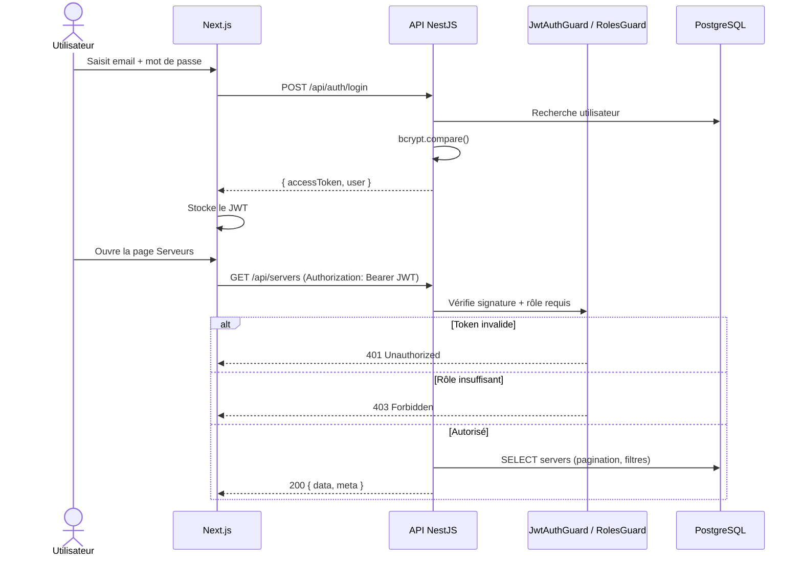
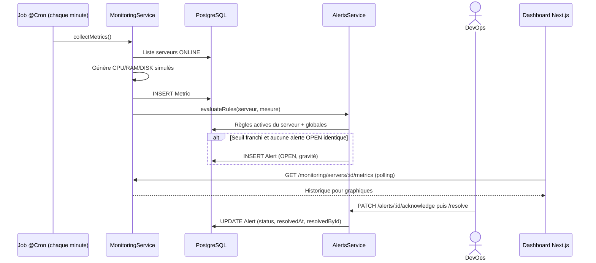

# CloudOps Manager — Dossier d'analyse et de conception (Semaines 1-2)

> Les diagrammes sont en **Mermaid** : ils s'affichent directement sur GitHub et peuvent être exportés en PNG/SVG
> via https://mermaid.live pour le rapport technique.

## 1. Acteurs et rôles

| Rôle | Description |
|---|---|
| **Admin** | Gère les utilisateurs et leurs rôles, a tous les droits sur les ressources |
| **DevOps** | Gère projets, serveurs, applications, règles d'alerte ; traite les incidents |
| **Viewer** | Consultation seule (dashboard, listes, graphiques, historique) |

## 2. Diagramme de cas d'utilisation



## 3. Diagramme de classes / modèle de données (10 entités)



## 4. Diagrammes de séquence

### 4.1 Authentification et accès protégé (JWT + RBAC)



### 4.2 Monitoring et déclenchement d'une alerte



## 5. Architecture

```mermaid
flowchart LR
  B[Navigateur] -->|HTTP :3000| FE[Next.js<br/>App Router]
  FE -->|REST + JWT :3001| API[NestJS<br/>Guards, DTO, Swagger]
  API --> ORM[Prisma]
  ORM --> PG[(PostgreSQL<br/>volume pgdata)]
  CRON[@nestjs/schedule<br/>mesures simulées + règles] --> API
  subgraph Docker Compose sur VPS/VM
    FE
    API
    ORM
    PG
    CRON
  end
```

Architecture backend : un module NestJS par domaine (`auth`, `users`, `projects`, `servers`, `applications`, `monitoring`, `alerts`, `dashboard`), avec controller → service → Prisma, DTO validés (class-validator), filtre d'exceptions global et guards globaux (`JwtAuthGuard` puis `RolesGuard`).

## 6. Matrice des permissions (RBAC)

| Action | Viewer | DevOps | Admin |
|---|:--:|:--:|:--:|
| Login, profil, dashboard, consultation (GET) | ✅ | ✅ | ✅ |
| CRUD projets, membres, environnements | ❌ | ✅ | ✅ |
| CRUD serveurs, applications | ❌ | ✅ | ✅ |
| CRUD règles d'alerte | ❌ | ✅ | ✅ |
| Acquitter / résoudre une alerte | ❌ | ✅ | ✅ |
| Supprimer projet / serveur | ❌ | ❌ | ✅ |
| Gérer utilisateurs et rôles | ❌ | ❌ | ✅ |

## 7. Liste des endpoints REST (42, objectif minimum : 20)

| Module | Endpoints |
|---|---|
| Auth (3) | `POST /auth/register` · `POST /auth/login` · `GET /auth/me` |
| Users (7) | `GET /users/me` · `PATCH /users/me` · `GET /users` · `GET /users/:id` · `PATCH /users/:id` · `PATCH /users/:id/role` · `DELETE /users/:id` |
| Projects (10) | `GET /projects` · `POST /projects` · `GET /projects/:id` · `PATCH /projects/:id` · `DELETE /projects/:id` · `POST /projects/:id/members` · `DELETE /projects/:id/members/:userId` · `GET /projects/:id/environments` · `POST /projects/:id/environments` · `DELETE /projects/:id/environments/:envId` |
| Servers (5) | `GET /servers` · `POST /servers` · `GET /servers/:id` · `PATCH /servers/:id` · `DELETE /servers/:id` |
| Applications (5) | `GET /applications` · `POST /applications` · `GET /applications/:id` · `PATCH /applications/:id` · `DELETE /applications/:id` |
| Monitoring (3) | `POST /monitoring/metrics` · `GET /monitoring/servers/:id/metrics` · `GET /monitoring/servers/:id/uptime` |
| Alerts (7) | `GET/POST /alert-rules` · `PATCH/DELETE /alert-rules/:id` · `GET /alerts` · `PATCH /alerts/:id/acknowledge` · `PATCH /alerts/:id/resolve` |
| Dashboard (2) | `GET /dashboard/summary` · `GET /dashboard/alerts-by-severity` |

Convention : listes paginées `?page=1&limit=10&search=...` + filtres propres à chaque ressource, réponse `{ data, meta: { total, page, limit, totalPages } }`.

## 8. Choix techniques justifiés

- **Prisma** : schéma déclaratif lisible (utile pour le rapport), migrations versionnées, client typé.
- **Guards globaux** : sécurité « fermée par défaut », `@Public()` pour les seules routes ouvertes.
- **Monitoring simulé** : job planifié, conforme au cahier des charges ; remplaçable plus tard par un agent réel ou des WebSockets (bonus).
- **Docker multi-stage** : images légères, migrations appliquées au démarrage, volume `pgdata` pour la persistance.
